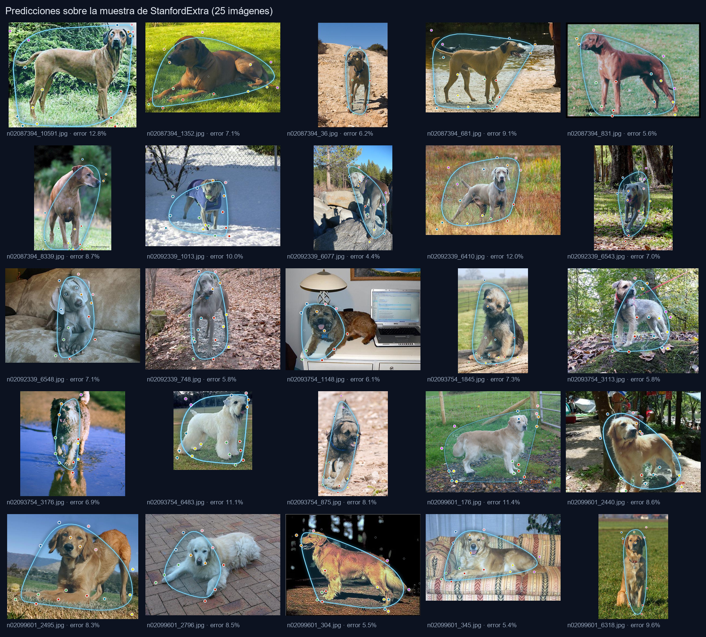
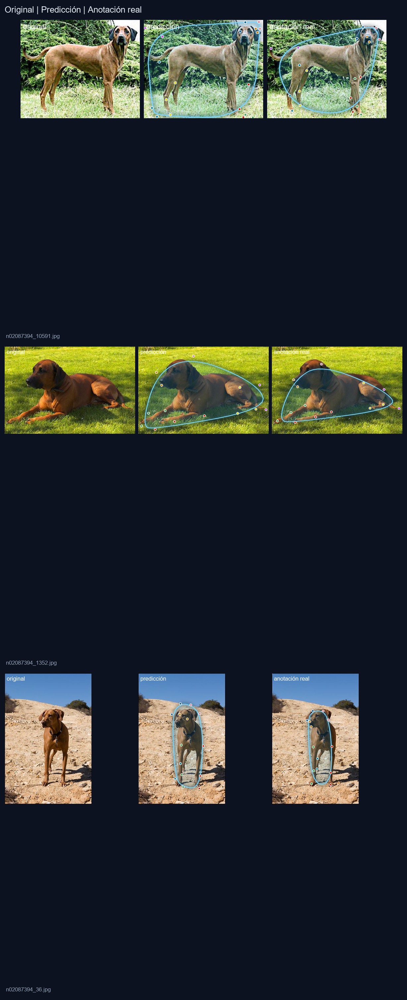

# 🐕 Detección de puntos clave en perros — cuaderno + app Streamlit

**Trabajo — viernes 23 de octubre de 2026**
**Asignatura:** Ciencia de Datos · Procesamiento de Imágenes (curso avanzado)
**Autor:** José Alejandro Téllez Prada

<p>


</p>


---

## 🎯 Qué es

Un detector de **24 puntos anatómicos** (keypoints) en imágenes de perros, entrenado con
**aprendizaje por transferencia** (MobileNetV2 preentrenado en ImageNet) y desplegado en una
app de **Streamlit** que, además de los puntos, dibuja un **contorno azul** con la silueta
estimada del animal.

```
Imagen 224×224×3
   → preprocess_input (MobileNetV2)
   → MobileNetV2 · ImageNet · último bloque entrenable
   → Dropout(0.3)
   → SeparableConv2D(72, 5×5, ReLU)
   → SeparableConv2D(72, 3×3, Sigmoid)      → 1×1×72
        ├── 48 coordenadas  (24 puntos × x, y) en [0, 1]
        └── 24 visibilidades (¿se ve el punto?)
```



---

## 📊 Resultados (25 imágenes de muestra, puntos visibles)

| Métrica | Cuaderno original (5 épocas) | Reentrenado |
|---|---|---|
| Error medio vs. anotación real | 27,44 % de la imagen | **7,94 %** |
| Error mediano | 25,95 % | **7,32 %** |
| Dispersión del esqueleto | 0,33 % → todos los puntos en un píxel | **31,27 %** |
| Acierto de visibilidad (20 puntos anotados) | — | **100 %** |
| Pérdida final | 0,095 | **0,00058** |

> El modelo original **no localizaba nada**: predecía el promedio del dataset y los 24 puntos
> se dibujaban uno encima de otro (de ahí que la app pareciera "no bordear" al perro).
> El diagnóstico completo está en el **Paso 15 del cuaderno**.



*(original · predicción · anotación real)*

---

## 📁 Contenido de la carpeta

| Archivo | Qué es |
|---|---|
| `Avanzada_Cuaderno_9D_Deteccion_puntos_clave2.ipynb` | Cuaderno del trabajo: material del curso ejecutado + diagnóstico + mejoras + resultados |
| `app_streamlit.py` | Aplicación de despliegue (interfaz, controles, descargas) |
| `puntos_clave.py` | Núcleo reutilizable: inferencia, envolvente/contorno, dibujo con anti-aliasing |
| `modelos/modelo_puntos_clave.keras` | Modelo entrenado (10,1 MB, Keras 3) |
| `entrenar_modelo.py` | Reentrenamiento reproducible (~4 min en CPU) |
| `evaluar_modelo.py` | Métricas por imagen + figuras en `resultados/` |
| `test_prediccion.py` | Verifica que el modelo carga y que los puntos **no** colapsan |
| `test_app.py` | Prueba E2E de la app con `streamlit.testing` |
| `muestras/` | 3 fotos para probar la app con un clic |
| `resultados/` | Figuras, métricas y captura de la app |
| `requirements.txt` | Dependencias |

> El dataset descargado (`StanfordExtra-master/`) no se versiona (ver `.gitignore`).

---

## 🚀 Cómo ejecutarlo

```bash
pip install -r requirements.txt
streamlit run app_streamlit.py
```

Abre `http://localhost:8501`, elige una imagen de muestra (o sube una foto) y la app devuelve
los 24 puntos con su contorno, la tabla de coordenadas y descargas en PNG/CSV.

### Reentrenar y evaluar

```bash
python entrenar_modelo.py     # deja el modelo en modelos/
python evaluar_modelo.py      # métricas + figuras en resultados/
python test_prediccion.py     # sanity check del modelo guardado
python test_app.py            # prueba E2E de la app
```

> `entrenar_modelo.py` y `evaluar_modelo.py` necesitan la carpeta `StanfordExtra-master/`,
> que el cuaderno descarga automáticamente (no se versiona porque pesa).

---

## 🧠 Qué se corrigió respecto al cuaderno base

El cuaderno del curso es correcto como material didáctico, pero tal cual entrena un modelo
que no sirve para desplegar. Los cuatro arreglos, con su justificación:

| # | Cambio | Por qué |
|---|---|---|
| 1 | **Descongelar el último bloque** de MobileNetV2 | Con el backbone 100 % congelado, 5 épocas y `lr = 1e-4`, la cabeza de regresión apenas se mueve y la red se queda en "predecir el promedio" |
| 2 | **Volteo horizontal con permutación izquierda/derecha** | `iaa.Fliplr(0.3)` voltea la imagen pero no las etiquetas: el 30 % de los datos de aumento quedaba mal etiquetado (una pata izquierda renombrada como derecha) |
| 3 | **Pérdida enmascarada por visibilidad** | La muestra de StanfordExtra **nunca** anota los puntos 20-23 (ojos, cruz, garganta). El cuaderno los entrena como si estuvieran en `(0,0)`, y ese error arrastraba el contorno hacia la esquina de la imagen |
| 4 | **Cabeza multi-tarea: 48 coordenadas + 24 visibilidades** | Permite que la app sepa qué puntos no se ven en una foto concreta y calcule el contorno solo con los visibles |

Bonus de rendimiento: las activaciones de la parte congelada se calculan **una sola vez** y
se reutilizan (`feat_extractor.predict`), así que entrenar 160 épocas tarda ~3 min en CPU en
lugar de ~1 h.

---

## 🖌️ Cómo se dibuja el "borde"

El modelo **no** hace segmentación; predice puntos. El contorno azul de la app es:

1. **Envolvente convexa** de los puntos que el modelo considera visibles (*monotone chain*).
2. **Suavizado de Chaikin** (3 iteraciones) para redondear las esquinas.
3. Dibujo con **supermuestreo ×3**, relleno translúcido y halo difuminado → bordes limpios
   sin necesidad de OpenCV.

Si un punto está mal, la envolvente se abre; por eso se excluyen los 4 puntos sin anotación
en el dataset y los que el modelo marca como no visibles (se dibujan como anillos tenues).

---

## ⚙️ CPU vs GPU

- **TensorFlow en Windows nativo no usa GPU** (limitación de TF ≥ 2.11: solo WSL2 o el
  complemento DirectML). El propio cuaderno lo advierte.
- Para este trabajo la **CPU alcanza**: 25 imágenes, 1,78 M parámetros entrenables y 160
  épocas sobre características cacheadas → **~3 minutos**.
- La **GPU RTX 4060** queda disponible para reentrenar con el dataset completo (12.000
  imágenes) o probar otras arquitecturas.

---

## ⚠️ Limitaciones

- **25 imágenes de muestra.** El modelo acierta en perros parecidos a los de la muestra, pero
  no es un detector de producción. El dataset completo de StanfordExtra tiene 12.000
  imágenes y se solicita por formulario a los autores.
- **Métricas optimistas.** Las cifras se midieron sobre las mismas 25 imágenes usadas para
  entrenar (no hay conjunto de prueba independiente).
- El contorno es una **estimación geométrica**, no una máscara de segmentación real.

### Siguientes pasos

- Dataset completo + `EarlyStopping` / `ReduceLROnPlateau`.
- *Fine-tuning* de más bloques del backbone y aumento más agresivo.
- Probar `EfficientNetB0`, `MobileNetV3` o un `Keypoint R-CNN`.
- Si se quiere un borde exacto: usar el campo `seg` del dataset (máscara RLE) y entrenar
  segmentación, o una red de dos cabezas (keypoints + máscara).

---

## 📚 Créditos y recursos

- **Dataset:** [StanfordExtra](https://github.com/benjiebob/StanfordExtra) — Benjamin Biggs
  et al., *Who Left the Dogs Out? 3D Animal Reconstruction with Expectation Maximization in
  the Loop* (ECCV 2020).
- **Cuaderno base:** *Detección de Puntos Clave con Aprendizaje por Transferencia*, Alfredo
  Díaz Claro (adaptación al español del trabajo de Sayak Paul y Muhammad Anas Raza).
- `imgaug`: [documentación](https://imgaug.readthedocs.io/)
- Transfer learning: [guía de Keras](https://keras.io/guides/transfer_learning/)
- MobileNetV2: [arXiv:1801.04381](https://arxiv.org/abs/1801.04381)

*Herramientas: Keras 3 · TensorFlow 2.20 · Streamlit 1.51 · Python 3.13 · NVIDIA RTX 4060.*
