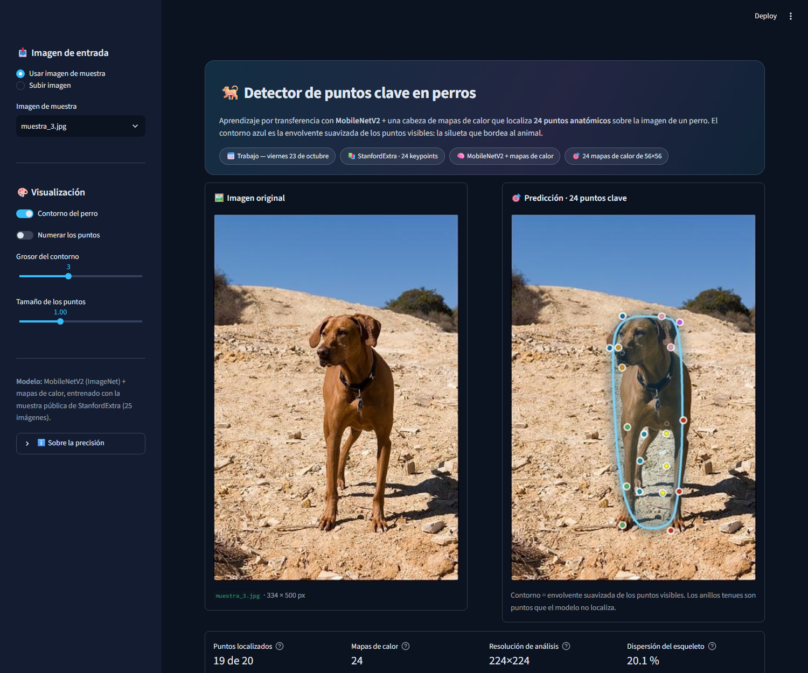
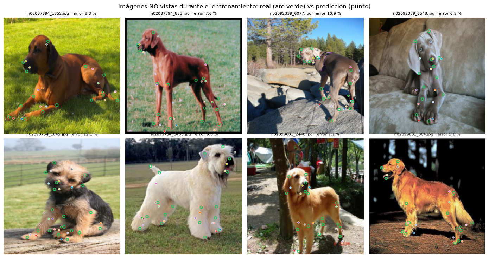

# 🐕 Detección de puntos clave en perros — Trabajo del viernes 23 de octubre

**Ciencia de Datos · Procesamiento de Imágenes (avanzado)** · Autor: José Alejandro Téllez Prada

Localiza **24 puntos anatómicos** de un perro (patas, orejas, ojos, nariz, cola…) en una foto y dibuja un
contorno que bordea la silueta. Parte del cuaderno `Avanzada_Cuaderno_9D_Deteccion_puntos_clave2.ipynb`
(aprendizaje por transferencia con **MobileNetV2**), que entrena el modelo y lo guarda; la app de **Streamlit**
carga ese modelo y hace las predicciones.



> ⚠️ **Es una demostración del pipeline, no un detector de producción.** Se entrenó con la muestra pública de
> StanfordExtra: **25 imágenes de 4 razas**. Funciona en perros parecidos a los de la muestra y falla con
> perros muy distintos. Ver [Limitaciones](#-limitaciones-y-siguientes-pasos).

---

## 📊 Resultados (medidos en imágenes que el modelo NO vio)

Validación cruzada de 5 pliegues: se entrena 5 veces dejando fuera 5 imágenes distintas y el error se mide
**solo en las imágenes que quedaron fuera**. Error = distancia media entre el punto predicho y el real, en %
del tamaño de la imagen (solo puntos anotados). La referencia es predecir siempre la **pose media**.

| | Error en imágenes no vistas |
|---|---|
| Pose media (referencia trivial) | **19,1 %** |
| **Este modelo (mapas de calor)** | **8,7 %** (por pliegue: 10,7 · 7,7 · 8,0 · 10,3 · 6,9) |
| Mismas imágenes de entrenamiento (no es generalización) | 2,2 % |

Otras cifras: acierto de visibilidad 77 % · modelo de 5,4 M de parámetros (22 MB) · entrenar los 5 pliegues
y el modelo final toma ≈ 15 min en una RTX 4060.

Predicciones sobre imágenes **no vistas** (aro verde = anotación real, punto = predicción):



Detalle en [`resultados/validacion_cruzada.json`](resultados/validacion_cruzada.json) y
[`resultados/validacion_cruzada.png`](resultados/validacion_cruzada.png).

---

## 🧠 Cómo funciona

```
Imagen 224×224×3 (uint8)
  → preprocess_input (MobileNetV2)
  → MobileNetV2 · ImageNet           (último bloque entrenable, BatchNorm congelado)   → 7×7×1280
  → 3 × [Conv2DTranspose(128, 4, stride 2) → BatchNorm → ReLU]                         → 56×56×128
  → Conv2D 1×1 (24)                                                                    → 56×56×24
```

* **Un mapa de calor por punto.** La posición del punto es el pico del mapa (refinada con un centroide local) y
  la **altura del pico** es la confianza de que el punto se vea. Los puntos con pico bajo (umbral 0,19, calibrado
  por validación cruzada) se dibujan como anillos tenues y no entran en el contorno.
* **Pérdida:** error cuadrático entre el mapa predicho y una gaussiana centrada en el punto real; el pico pesa
  30 veces más que el fondo y los puntos no anotados casi no cuentan.
* **Contorno:** no es una máscara de segmentación; es la envolvente convexa de los puntos visibles, suavizada
  con el algoritmo de Chaikin.
* **Datos:** en la muestra, los puntos 20-23 (ojos, cruz y garganta) **nunca vienen anotados**; el modelo no tiene
  señal para ellos y la app los dibuja como anillos.

---

## 🛠️ Qué se corrigió respecto a la primera versión

La primera versión de este trabajo daba predicciones que no seguían al perro. Auditoría y causas:

| Problema | Efecto | Corrección |
|---|---|---|
| Regresión directa de 48 coordenadas tras un pooling global | En imágenes no vistas el error era ≈ 20 %, igual que predecir la pose media: no localizaba | **Mapas de calor** |
| El cuaderno entrenaba 25 pasos y **no guardaba el modelo**; el modelo de la app salía de otro script distinto | El cuaderno y la app no eran consistentes | El cuaderno es ahora la fuente: entrena, valida y guarda el modelo |
| El error del README (7,9 %) se calculó sobre las mismas 25 imágenes de entrenamiento | Cifra optimista, sin valor de generalización | Validación cruzada: la cifra es 8,7 % **en imágenes no vistas** |
| Volteo horizontal sin intercambiar izquierda/derecha | Etiquetas contradictorias en parte de los datos | El volteo intercambia las etiquetas |
| Puntos no anotados entrenados como (0, 0) | Arrastraban las predicciones a la esquina | Mapa en cero y peso casi nulo |
| Aumento que saca un punto del cuadro seguía contando como visible | Ruido de etiquetas | Se marca como no visible |
| BatchNorm entrenable con lotes pequeños | Desajuste entrenamiento/inferencia | BatchNorm del backbone en modo inferencia |
| La app no corregía la orientación EXIF | Fotos de celular llegaban rotadas al modelo | `ImageOps.exif_transpose` |
| Pruebas sin aserciones (`test_app.py`) o que salían con código 0 ante un error | Pasaban aunque fallaran | Aserciones y código de salida 1 |

---

## 🚀 Uso

### Ejecutar la app

```bash
pip install -r requirements.txt
streamlit run app_streamlit.py
```

Abre `http://localhost:8501`. El modelo (22 MB) ya viene en `modelos/`: no hace falta entrenar para probarla.
Se puede elegir una de las 3 muestras o subir una foto propia, activar/desactivar el contorno, numerar los puntos
y descargar la imagen anotada (PNG) y las coordenadas (CSV).

### Reentrenar el modelo

* **Cuaderno** (recomendado): abre `Avanzada_Cuaderno_9D_Deteccion_puntos_clave2.ipynb` y ejecútalo completo.
  Funciona en **Google Colab con GPU** (descarga solo la muestra de StanfordExtra) o en local.
* **Script equivalente:** `python entrenar_modelo.py` hace lo mismo sin Jupyter (`--rapido` para una prueba de humo).

**GPU:** TensorFlow en Windows nativo ya no usa la GPU. Con **PyTorch** instalado (con CUDA) el cuaderno y el
script entrenan en la GPU automáticamente: Keras 3 usa el backend de PyTorch y el `.keras` resultante lo carga la
app con cualquier backend. En CPU, los 5 pliegues + modelo final tardan ≈ 1 h.

### Evaluar y probar

```bash
python evaluar_modelo.py     # figuras sobre las 25 imágenes de entrenamiento (referencia, no mide generalización)
python test_prediccion.py    # el modelo carga, devuelve 56×56×24 y los puntos no colapsan (código 1 si falla)
python test_app.py           # prueba de extremo a extremo de la app con streamlit.testing
```

---

## 📁 Estructura

```
Trabajo_23_Oct_Puntos_Clave_Streamlit/
├── Avanzada_Cuaderno_9D_Deteccion_puntos_clave2.ipynb   # entrena, valida y guarda el modelo (ejecutado)
├── app_streamlit.py          # interfaz Streamlit
├── puntos_clave.py           # inferencia, contorno y dibujo (reutilizable)
├── entrenar_modelo.py        # mismo entrenamiento que el cuaderno, por línea de comandos
├── evaluar_modelo.py         # figuras sobre la muestra
├── test_prediccion.py · test_app.py
├── modelos/modelo_puntos_clave.keras
├── muestras/                 # 3 fotos de ejemplo
├── resultados/               # validación cruzada, figuras y capturas
└── requirements.txt
```

`puntos_clave.py` se puede usar desde cualquier script:

```python
from PIL import Image
from puntos_clave import cargar_modelo, predecir, dibujar

modelo = cargar_modelo("modelos/modelo_puntos_clave.keras")
img = Image.open("muestras/rhodesian_1.jpg").convert("RGB")
kps, vis = predecir(modelo, img)     # (24, 2) en [0,1]  y  (24,) de confianza de visibilidad
dibujar(img, kps, vis=vis).save("salida.png")
```

---

## ⚠️ Limitaciones y siguientes pasos

* **Solo 25 imágenes de 4 razas** (Rhodesian ridgeback, Weimaraner, Border terrier, Golden retriever). El error de
  8,7 % es la cifra honesta con ese dato, pero cada pliegue tiene solo 5 imágenes y la estimación es ruidosa.
* **Perros muy distintos o poses raras** (cachorros, perros acostados de espaldas, varios perros) pueden fallar.
* **Siguiente paso real:** entrenar con el StanfordExtra completo (≈ 12 000 imágenes, se solicita a los autores en
  [benjiebob/StanfordExtra](https://github.com/benjiebob/StanfordExtra)): basta apuntar `JSON_PATH` del cuaderno al
  JSON completo y ejecutarlo en Colab con GPU.

## 📚 Créditos

* **Dataset:** [StanfordExtra](https://github.com/benjiebob/StanfordExtra) — B. Biggs et al., *Who Left the Dogs Out?
  3D Animal Reconstruction with Expectation Maximization in the Loop* (ECCV 2020). Imágenes del
  [Stanford Dogs Dataset](http://vision.stanford.edu/aditya86/ImageNetDogs/). Licencia propia (uso académico).
* **Modelo base:** MobileNetV2 (Sandler et al., 2018) vía `keras.applications`.
* **Idea del cuaderno:** *Detección de puntos clave con aprendizaje por transferencia* (Alfredo Díaz Claro, sobre el
  trabajo de Sayak Paul y Muhammad Anas Raza).
